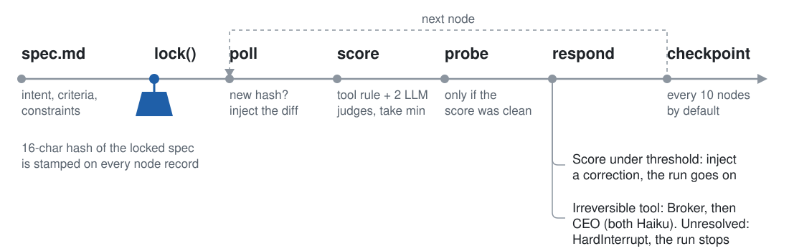

<div align="center">

# ballast

A spec-verification kernel for long-running multi-agent systems: it locks a run's intent, scores every agent step against it, and applies spec changes mid-run without a restart.

<picture>
  <source media="(prefers-color-scheme: dark)" srcset="docs/how-it-works-dark.svg">
  
</picture>

<sub>One agent node, checked against a spec locked before the run.</sub>

</div>

## Why

Agents drift from their original intent mid-run, and today you only notice afterwards and restart the job. ballast locks the intent before execution, checks every node against it, reports drift as typed events, and lets you change the spec between nodes while the run continues.

The spec server is meant to run on one machine (called M5 in the code) and the agent on another (M2). Both can run on one machine.

## How it works

### 1. Lock the spec before anything runs

Write a `spec.md`. Call `parse_spec()` + `lock()`. The locked `SpecModel` carries a version hash over every field except `harness`, `locked_at` and the hash itself (`spec.py:lock`). No agent touches a task without a locked spec attached.

```python
from ballast.core.spec import parse_spec, lock

spec = lock(parse_spec("spec.md"))
# spec.version_hash = "17de212b39a16812"  — 16 hex chars, deterministic over all non-harness fields
# spec.locked_at = ISO-8601 UTC timestamp
```

### 2. Run the agent through `run_with_spec`

`trajectory.py` wraps `Agent.iter`. At every node boundary it scores three dimensions (`score_drift`):

| Dimension | Method | How |
|-----------|--------|-----|
| Tool compliance | `score_tool_compliance` | Rule-based — is tool in `allowed_tools`? |
| Constraint violation | `score_constraint_violation` | LLM judge (`claude-sonnet-4-6`) |
| Intent alignment | `score_intent_alignment` | LLM judge (`claude-sonnet-4-6`) |

Aggregate score = `min(tool, constraint, intent)`. Scores of 0.85 or more are `PROGRESSING`, 0.25 or less `VIOLATED`; in between, a Haiku evaluator (Layer 2) decides if `enable_layer2_judge` is on. A tool listed in `irreversible_actions` is `VIOLATED_IRREVERSIBLE` before any LLM call. In `run_with_spec`, a score below `spec.drift_threshold` (or a `VIOLATED` label) injects a correction message and the run continues; `DriftDetected` is raised only by `TrajectoryChecker`.

### 3. Inject live spec updates between nodes

While the agent runs on M2, you can update the spec on M5:

```python
# M5 side — push an updated spec mid-run
httpx.post("http://m5:8765/spec/job-001/update", json=spec_v2.model_dump())
```

`SpecPoller.poll()` detects the version change at the next node boundary, computes a `SpecDelta`, and injects it into the agent's `message_history` as plain text:

```
[BALLAST SPEC UPDATE: 17de212b → 07931816]
NEW CONSTRAINTS (apply immediately): do not mention OpenAI or Anthropic
[Continue from current node under updated spec.]
```

The agent reads this as context and adjusts. The spec version hash in the audit log changes at exactly the node where the injection fired.

### 4. Drift escalation

Drift and escalation in `run_with_spec` (`trajectory.py`, `guardrails.py`, `escalation.py`):

```
node scored below drift_threshold, or labelled VIOLATED
    └── build_correction() message injected, run continues

node calls a tool in irreversible_actions
    └── escalate(): Broker (Haiku) → CEO (Haiku) → human level
         ├── Broker or CEO returns a resolution → injected, run continues
         └── neither resolves → EscalationFailed → HardInterrupt,
             checkpoint written, run stops
```

The spec never changes during escalation; the injected correction or resolution only changes what the agent does next. The human level is not implemented as a dashboard or timeout: it raises `EscalationFailed` (`escalation.py:escalate`).

---

## The spec format

```markdown
# spec v1

## intent
One sentence. What the agent is trying to achieve.

## success criteria
- criterion 1
- criterion 2

## constraints
- what the agent must never do

## escalation threshold
drift confidence floor: 0.4
timeout before CEO decides: 300 seconds

## tools allowed
- tool_name
```

`parse_spec` reads the timeout line into `harness.escalation_timeout_seconds`, but nothing else in `ballast/` uses that field yet.

---

## Project layout

```
ballast/
├── core/
│   ├── spec.py          — SpecModel, SpecDelta, parse_spec, lock, diff
│   ├── trajectory.py    — drift scoring, TrajectoryChecker, run_with_spec
│   ├── hook.py          — run_with_live_spec: spec polling and injection only
│   ├── guardrails.py    — build_correction, HardInterrupt, can_resume
│   ├── escalation.py    — Broker → CEO → human chain
│   ├── evaluator.py     — Layer-2 judge for ambiguous scores
│   ├── probe.py         — environment probe for PROGRESSING nodes
│   ├── cost.py          — RunCostGuard spend caps
│   ├── checkpoint.py    — ballast-progress.json
│   ├── dashboard.py     — Textual TUI over the checkpoint file
│   ├── server.py        — FastAPI spec server (M5 side)
│   ├── sync.py          — SpecPoller client (M2 side)
│   ├── memory.py        — per-run outcome storage, domain thresholds
│   ├── node_tools.py, agent_output.py, constants.py
│   └── stream.py        — AgentStream ABC
├── adapters/
│   ├── agui.py          — AG-UI protocol adapter
│   ├── otel.py          — emit_drift_span
│   └── tinyfish.py      — stub, raises NotImplementedError
scripts/
├── server.py            — uvicorn entrypoint: python scripts/server.py
└── observe.py           — live observation script (in progress)
tests/
└── test_*.py            — one file per module in core/ and adapters/
spec.md                  — sample spec (word count task)
demo.py                  — end-to-end demo; needs ANTHROPIC_API_KEY and the server running
```

---

## Setup

```bash
git clone <repo>
cd ballast
python -m venv venv && source venv/bin/activate
pip install -e ".[dev]"

cp .env.example .env
# add ANTHROPIC_API_KEY to .env

# run the tests that need no API key (293 passed in one run)
pytest tests/ -m "not integration"

# run the spec server
python scripts/server.py
```

---

## Build status

| Component | Status | Notes |
|-----------|--------|-------|
| `spec.py` — parse, lock, diff, inject | done | `SpecModel`, `SpecDelta`, `as_injection()` |
| `trajectory.py` — node scoring | done | tool/constraint/intent, escalation, probe, OTel |
| `server.py` + `sync.py` — live updates | done | FastAPI + `SpecPoller`; optional `BALLAST_SPEC_SERVER_TOKEN` on POST |
| `guardrails.py` — corrections + resume | done | `build_correction`, `HardInterrupt`, `can_resume` |
| `cost.py` — spend caps | done | per-agent + global cap, default `HARD_CAP_USD` = 300; `RunCostGuard` is optional in `run_with_spec` |
| `dashboard.py` — Textual TUI | done | live `ballast-progress.json` |
| `adapters/otel.py` — typed spans | done | `emit_drift_span` for drift / violations |
| `adapters/tinyfish.py` | stub | raises `NotImplementedError` |
| `adapters/smolagents.py` — M2 workers | planned | worker adapter for non–pydantic-ai runtimes |

---

## Architectural invariants

Design rules the code is written to.

1. **Spec locks before any agent executes.** No agent touches a task without a locked `SpecModel` attached.
2. **Spec version travels with every job.** The checkpoint and audit log record the version hash for every node.
3. **Drift detection runs at every node.** `trajectory.py` hooks into `Agent.iter` — not just at task completion.
4. **Escalation never drops context.** Full node history + spec version + drift score travels with every escalation.
5. **Cost cap enforced in code.** When a `RunCostGuard` is passed to `run_with_spec`, exceeding the cap raises. The cap defaults to 300 USD and is a constructor argument (`cost.py:200`).
6. **`spec_violation` is a typed OTel span.** `emit_drift_span` fires for every non-`PROGRESSING` node (`adapters/otel.py`).
